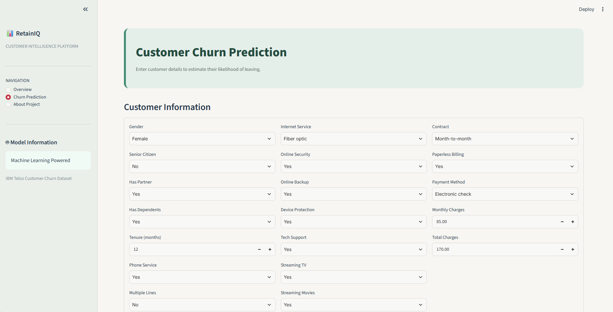
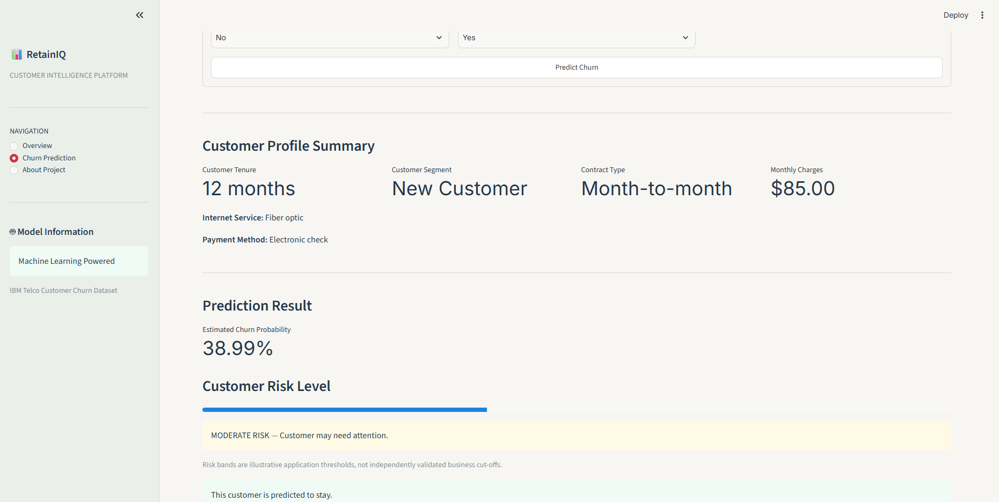
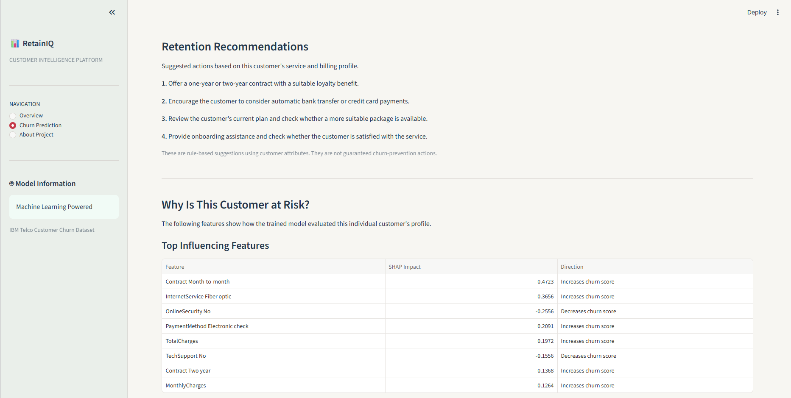
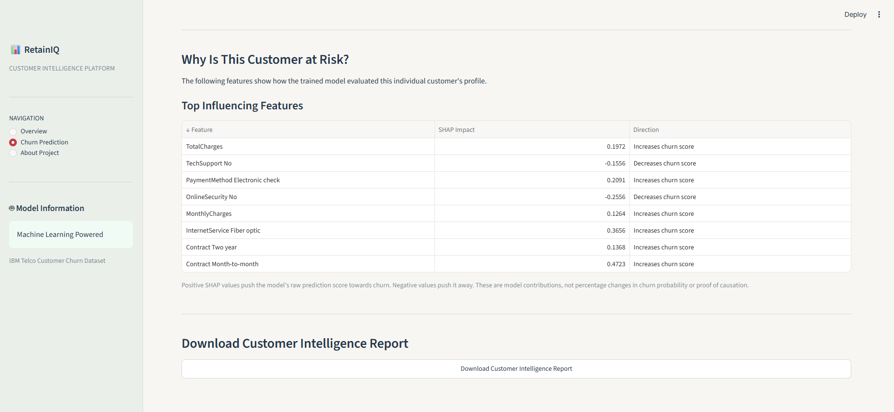
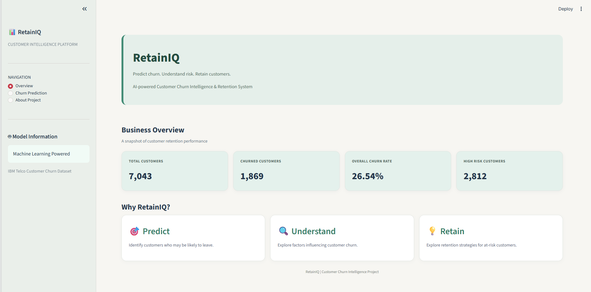
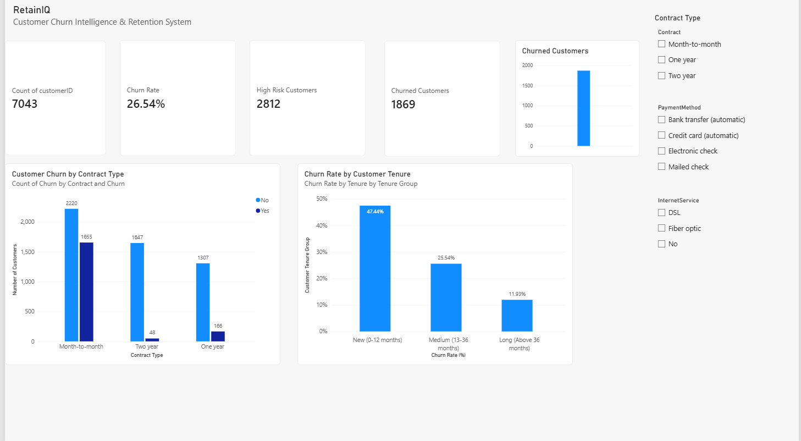
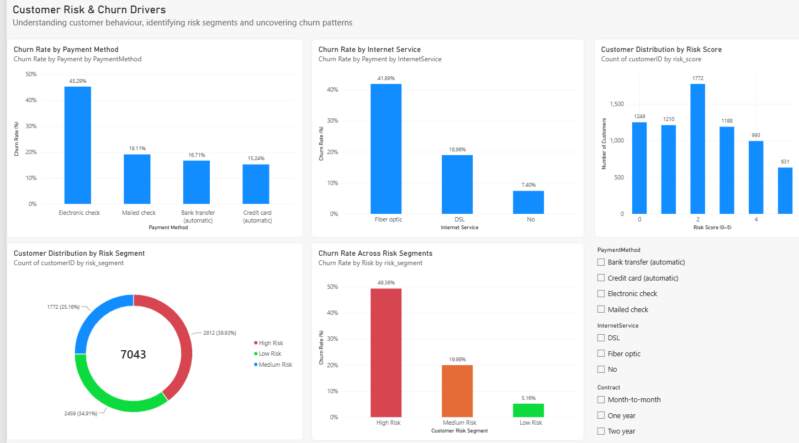
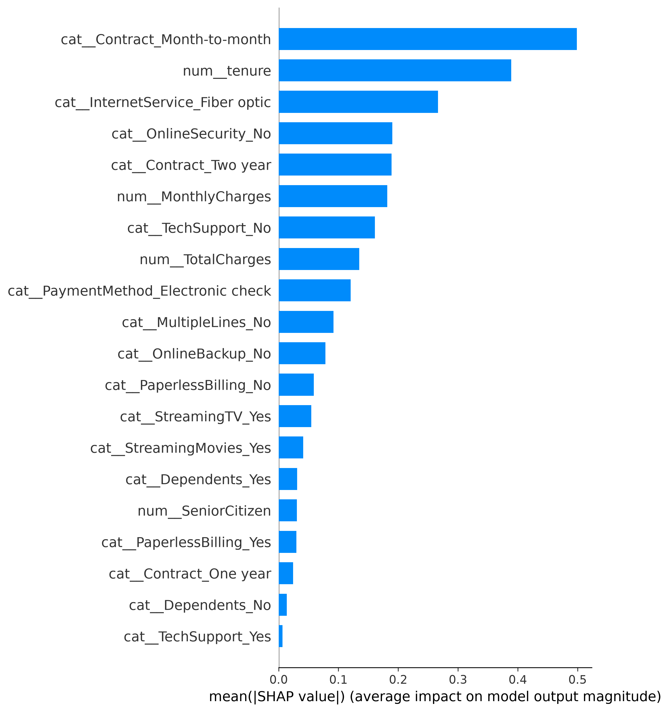
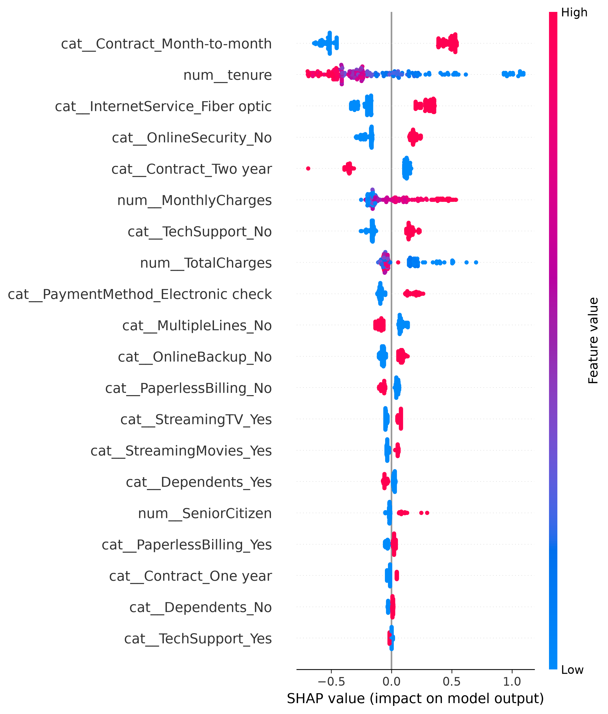

# RetainIQ — Customer Churn Intelligence & Retention System

An end-to-end machine learning project that analyzes customer churn, identifies potential churn risks, explains model predictions, and supports data-driven customer retention decisions.

## Overview

Customer churn is a major challenge for subscription-based businesses. RetainIQ uses the IBM Telco Customer Churn dataset to explore customer behavior, identify patterns associated with churn, and build a machine learning model to estimate the likelihood of customer attrition.

The project combines exploratory data analysis, SQL analytics, machine learning, model explainability, Power BI visualization, and an interactive Streamlit application.

## Objectives

- Analyze customer churn patterns and identify important contributing factors.
- Perform data cleaning, preprocessing, and feature engineering.
- Compare and evaluate multiple classification algorithms.
- Tune model hyperparameters to improve predictive performance.
- Interpret model predictions using SHAP explainability.
- Perform SQL-based customer and churn analysis.
- Develop an interactive Power BI dashboard.
- Build a Streamlit application for customer-level churn prediction and retention suggestions.

## Dataset

**Source:** IBM Telco Customer Churn Dataset

The dataset contains 7,043 customer records and 21 columns, including demographic information, account details, subscribed services, billing information, and churn status.

**Target variable:** `Churn` (`Yes` / `No`)

The dataset is a customer-level snapshot. It supports churn-pattern analysis but does not provide a complete longitudinal record of customer activity.

## Technology Stack

| Area | Tools |
|---|---|
| Programming | Python |
| Data Analysis | Pandas, NumPy |
| Visualization | Matplotlib, Seaborn |
| Machine Learning | Scikit-learn |
| Explainable AI | SHAP |
| Database | SQLite, SQL |
| Dashboard | Power BI |
| Web Application | Streamlit |
| Model Persistence | Joblib |
| Development | Jupyter Notebook, VS Code |

## Project Workflow

1. **Data Understanding:** Explore dataset dimensions, columns, data types, and distributions.
2. **Data Cleaning:** Handle missing values, correct data types, and prepare the cleaned dataset.
3. **Exploratory Data Analysis:** Examine churn distribution and relationships between churn and customer characteristics.
4. **Feature Engineering and Model Development:** Prepare features, build preprocessing pipelines, train classification models, compare performance, and tune hyperparameters.
5. **Model Explainability:** Use SHAP to understand feature contributions to model predictions.
6. **SQL Analytics:** Analyze churn patterns, customer segments, and rule-based risk categories.
7. **Power BI Dashboard:** Present customer metrics, churn drivers, and risk-segment analysis.
8. **Streamlit Application:** Provide customer-level churn predictions, risk summaries, SHAP explanations, and retention suggestions.

## Machine Learning

The project compares the following classification algorithms:

- Logistic Regression
- Decision Tree
- Random Forest
- Gradient Boosting

Model evaluation considers accuracy, precision, recall, F1-score, ROC-AUC, and PR-AUC.

The saved application model is the tuned Gradient Boosting pipeline.

### Saved Model — Validation Performance

| Metric | Score |
|---|---:|
| Accuracy | 81.01% |
| Precision | 70.14% |
| Recall | 49.50% |
| F1-score | 58.04% |
| ROC-AUC | 0.8515 |
| PR-AUC | 0.6714 |

These are validation-set results, not a claim of guaranteed performance on future customers.

## Explainable AI

SHAP is used to interpret the saved Gradient Boosting model.

The analysis highlights important features associated with model predictions, including:

- Contract type
- Customer tenure
- Internet service
- Online security
- Monthly charges
- Technical support
- Payment method

SHAP values explain model behavior; they do not establish causal relationships.

## SQL Analytics

SQLite is used to store customer data and perform analytical queries, including:

- Overall customer and churn counts.
- Churn rate by contract type.
- Churn rate by tenure group.
- Churn rate by payment method.
- Churn rate by internet service.
- Rule-based customer risk segmentation.

The risk segments are heuristic categories based on selected customer characteristics, not outputs of the trained machine learning model.


## Application Preview

### Streamlit Application

RetainIQ provides an interactive interface for customer churn prediction, risk assessment, SHAP explanations, and retention recommendations.











### Power BI Dashboard

#### Executive Overview



#### Churn Drivers and Risk Analysis



### SHAP Explainability

#### Feature Importance



#### SHAP Beeswarm Plot



## Power BI Dashboard

The Power BI dashboard presents two analytical views:

**Executive Overview**
- Total customers
- Churned customers
- Overall churn rate
- High-risk customer count
- Churn by contract type
- Churn by tenure group

**Churn Drivers & Risk**
- Churn by payment method
- Churn by internet service
- Customer distribution by risk segment
- Churn rate by risk segment
- Risk score distribution

## Streamlit Application

The interactive application allows users to:

- Enter customer information.
- Generate a churn prediction using the saved model.
- View estimated churn probability and risk category.
- Explore customer profile details.
- View SHAP-based feature contributions.
- Receive rule-based retention suggestions.
- Download a customer intelligence report as CSV.

## Project Structure

```text
RetainIQ/
│
├── app/
│   └── app.py
│
├── data/
│   ├── raw/
│   │   └── telco_churn.csv
│   └── processed/
│       ├── telco_churn_clean.csv
│       ├── customers_for_powerbi.csv
│       └── customer_risk_segments.csv
│
├── database/
│   └── retainiq.db
│
├── models/
│   └── best_gradient_boosting.pkl
│
├── notebooks/
│   ├── 01_data_understanding.ipynb
│   ├── 04_feature_engineering.ipynb
│   ├── 06_model_explainability.ipynb
│   └── 07_sql_analytics.ipynb
│
├── reports/
│   ├── shap_beeswarm.png
│   └── shap_feature_importance.png
│
├── sql/
│   ├── schema.sql
│   └── analysis.sql
│
├── RetainIQ_Dashboard.pbix
├── requirements.txt
├── .gitignore
└── README.md
```

## Installation and Setup

### 1. Clone the repository

```bash
git clone https://github.com/navyavishwakarma/RetainIQ.git
cd RetainIQ
```

### 2. Create a virtual environment

```bash
python -m venv venv
```

Activate it on Windows:

```powershell
venv\Scripts\activate
```

### 3. Install dependencies

```bash
python -m pip install -r requirements.txt
```

### 4. Run the Streamlit application

```bash
python -m streamlit run app/app.py
```

The application will open in your browser.

## Future